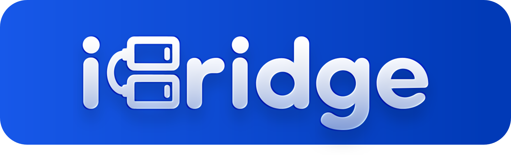
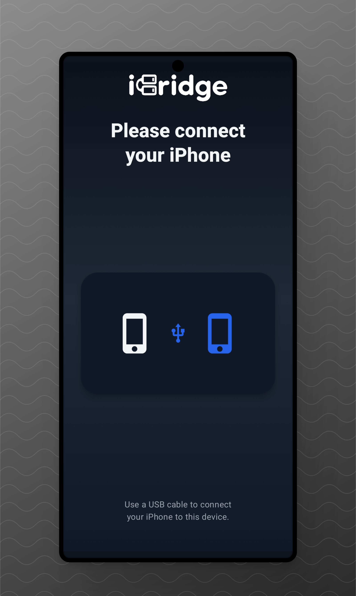
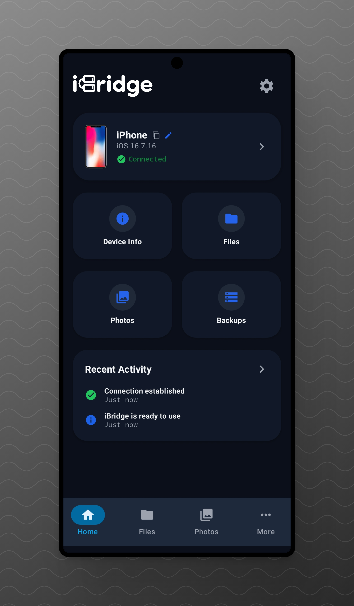
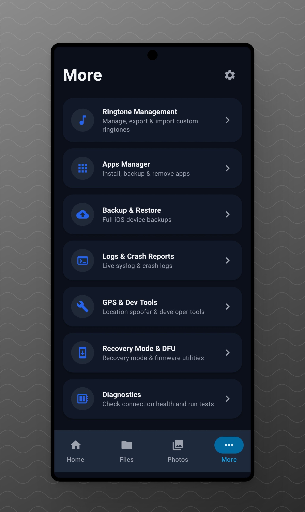

# iBridge

**Bridge Android and iPhone**

An Android application that connects to iPhone over USB to provide device information, file access, backups, ringtone management, and more.

---

## Table of Contents

- [Features](#features)
- [Screenshots](#screenshots)
- [Download & Installation](#download--installation)
- [Requirements](#requirements)
- [How It Works](#how-it-works)
- [Compatibility & Limitations](#compatibility--limitations)
- [Built With](#built-with)
- [Roadmap](#roadmap)
- [Contributing](#contributing)
- [License](#license)
- [Acknowledgements](#acknowledgements)

---

## Features

### USB Connection & Device Detection

- Guided connection wizard with automatic iPhone detection.
- USB access and device trust instructions.
- Connection status and recent activity dashboard.
- Pairing and session lifecycle management.

### System Information

- Detailed iPhone hardware and software specifications.
- iOS version, build number, device model, and identifiers.
- Battery status and storage usage.
- Tap-to-copy device information.

### File & Photo Access

- Browse supported iPhone files over USB.
- Access DCIM folders and browse photos.
- Navigate supported device directories without unnecessary media scanning.

### Ringtone Management

- Import audio files and trim them using an interactive waveform editor.
- Convert supported audio formats for ringtone use.
- Browse, rename, export, and delete detected ringtones.
- Automatic backups, SHA-256 verification, and rollback safeguards.

> **Note:** Ringtone management is not guaranteed to work on modern iOS versions, especially iOS 17 and later.

### Backup & Restore

- Create and restore supported iPhone backups.
- Manage backup operations through a dedicated interface.

### Additional Tools

- **Apps Manager** — Install, back up, and uninstall iOS apps.
- **Logs & Crash Reports** — Access available system logs and crash reports.
- **Diagnostics** — Inspect connection and application status.
- **Developer Tools** — Additional utilities, including experimental features.

### Modern Interface

- Material 3 Expressive-inspired design.
- Light, Dark, and System Default themes.
- Dedicated Home dashboard and System Information screens.
- Streamlined navigation and guided onboarding.

### Session Management

- Background process cleanup when the app is dismissed.
- Pairing/trust session resets on app lifecycle events and USB disconnection.

---
## Screenshots

Explore iBridge's interface, from connecting your iPhone to managing its information and files.
| Connection Wizard | Home Screen | More Options |
|:---:|:---:|:---:|
|  |  |  |
---

## Download & Installation

### Download

Get the latest available version of iBridge from the official GitHub releases page.

**[Download iBridge](https://github.com/adammg-tech/iBridge/releases)**

### Installation

1. Download the iBridge APK from the releases page.
2. Open the downloaded APK on your Android device.
3. Allow installation from your browser or file manager if Android requests permission.
4. Complete the installation and launch iBridge.
5. Connect your iPhone to your Android device using a compatible USB connection.
6. Follow the in-app connection wizard and respond to any trust prompts on your iPhone.

> Only install APKs from sources you trust. USB accessories, adapters, and cable compatibility may affect the connection.

---

## Requirements

### Android Device

- An Android device capable of running the installed iBridge APK.
- USB host/OTG support and a compatible USB connection.
- Sufficient storage for application data, exported files, and backups.
- Permission to access the connected USB device when prompted.

### iPhone

- An iPhone with a compatible USB connection.
- The ability to respond to the device trust prompt when required.
- A supported iOS version for the particular feature being used.

### Additional Considerations

- A compatible USB cable or adapter may be required.
- Certain features may require additional device permissions or services.
- Feature availability can vary depending on the iPhone model, iOS version, and Apple security restrictions.

---

## How It Works

iBridge connects an Android device to an iPhone over USB, using the application's device communication framework and supported Apple device services.

### Connection Workflow

1. **Connect** — Attach the iPhone to the Android device over USB.
2. **Grant USB Access** — Allow iBridge to communicate with the connected device.
3. **Establish Trust** — Follow the iPhone's trust instructions when prompted.
4. **Initialize Services** — iBridge establishes the communication session and initializes the required services.
5. **Use iBridge** — Access the supported features available for the connected device.

### Under the Hood

- **USB Communication** — Provides the physical connection between Android and iPhone.
- **usbmuxd** — Multiplexes supported communications with Apple mobile devices.
- **libimobiledevice** — Provides access to supported Apple device protocols and services.
- **AFC** — Supports file-related operations exposed through Apple's Apple File Conduit service.
- **Device Services** — Enable supported functionality such as device information, backups, and diagnostics.

The exact operations available depend on the services exposed by the connected iPhone and the implementation of each iBridge feature.

---

## Compatibility & Limitations

iBridge relies on USB connectivity, Apple device services, and iOS-version-dependent behavior. Not every feature is guaranteed to work on every device.

### General Limitations

- USB access and device trust must be established successfully.
- Apple security restrictions may limit access to certain files, settings, and services.
- Some operations may behave differently across iPhone models and iOS versions.
- Features requiring unsupported or restricted Apple services may be unavailable.

### Ringtone Management

**Custom ringtone management is not guaranteed to work on modern iOS versions, especially iOS 17 and later.**

Changes to filesystem access, security restrictions, and ringtone handling may prevent some operations from working as expected.

- Back up relevant files before modifying ringtone data.
- Do not assume that successful USB connectivity guarantees ringtone compatibility.
- Use ringtone modification and restoration features with caution.

### Experimental Features

The following features have not yet been tested and should be considered experimental:

- **GPS & Developer Tools** — Including location spoofing.
- **Recovery Mode & DFU** — Including recovery-mode management and IPSW firmware flashing.

Do not rely on these features for critical operations until they have been tested and verified.

---

## Built With

iBridge combines Android application development with tools and protocols for communicating with Apple mobile devices.

- **Android** — Application platform.
- **Material Design 3** — Modern interface and theming.
- **libimobiledevice** — Communication with supported Apple device services.
- **usbmuxd** — USB device communication multiplexing.
- **AFC** — Supported iPhone filesystem operations.
- **Git & GitHub** — Version control and project hosting.

*This list describes the principal technologies used by the project. Refer to the source code and dependency configuration for the exact libraries, versions, and implementation details.*

---

## Roadmap

iBridge is actively evolving. Potential future improvements include:

- [ ] Improve compatibility across additional iPhone models and iOS versions.
- [ ] Expand ringtone management reliability and recovery safeguards.
- [ ] Test and improve experimental GPS and developer tools.
- [ ] Validate Recovery Mode, DFU, and firmware-related functionality.
- [ ] Improve diagnostics and connection troubleshooting.
- [ ] Refine the user interface and accessibility.
- [ ] Expand documentation and developer onboarding.
- [ ] Prepare additional distribution options.

Roadmap items are goals, not promises or confirmation that a feature is currently implemented.

---

## Contributing

Contributions, bug reports, and suggestions are welcome.

### Reporting Issues

When reporting a bug, please include:

- Your Android device model and Android version.
- Your iPhone model and iOS version.
- The iBridge version you are using.
- Steps to reproduce the issue.
- Relevant application logs or error messages, with personal information removed.

### Submitting Changes

1. Fork the repository.
2. Create a branch for your changes.
3. Implement and test your changes.
4. Submit a pull request describing what changed and how it was tested.

Please avoid submitting untested changes that could risk user data or device functionality.

For substantial changes, consider opening an issue first to discuss the proposed implementation.

---

## License

iBridge is licensed under the **Apache License 2.0**.

You may use, modify, and redistribute the project in accordance with the license's terms and conditions.

See the [`LICENSE`](LICENSE) file for the complete license text.

Copyright © Adam MG Alsherif.

---

## Acknowledgements

iBridge builds upon the work of the open-source community.

- **[libimobiledevice](https://github.com/libimobiledevice/libimobiledevice)** — For tools and libraries that enable communication with Apple mobile devices.
- **[usbmuxd](https://github.com/libimobiledevice/usbmuxd)** — For USB multiplexing support used in Apple device communication.
- **[Android Open Source Project](https://source.android.com/)** — For the Android platform and its developer ecosystem.
- **[Material Design](https://m3.material.io/)** — For design guidance and interface components.
- **Contributors and testers** — For helping improve the project.
- This project was built and developed with the assistance of AI. 
---

Please refer to the respective projects for their licenses, attribution requirements, and additional acknowledgements.

---
**iBridge — Bridge Android and iPhone.**
